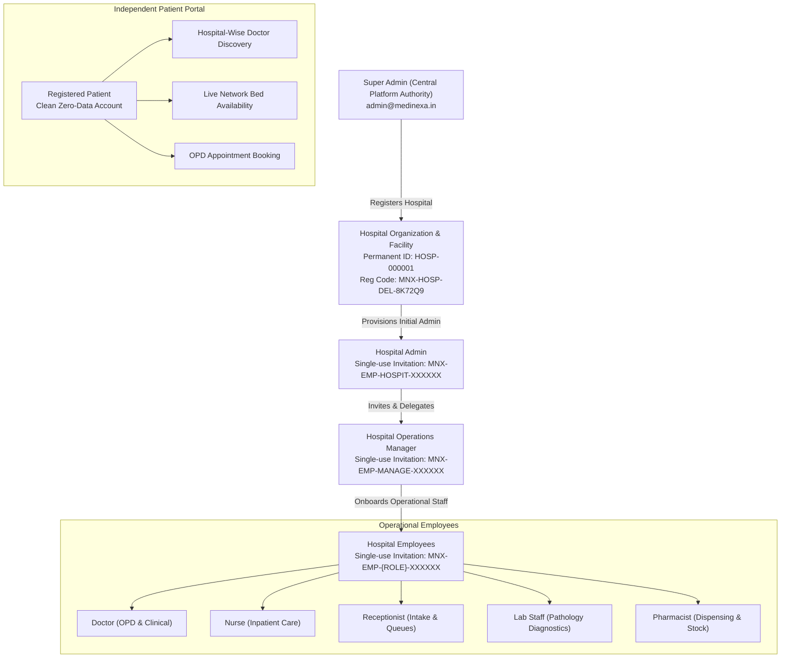

# MEDINEXA HOSPITAL ONBOARDING & ACCESS-CONTROL ARCHITECTURE

**Document Version:** 1.0.0  
**Target Environment:** Production (`medinexa-medicalweb.vercel.app` & `medinexa-duplicate-api.onrender.com`)  
**Architecture Classification:** Enterprise Connected Healthcare HMS & Clinical Operating System  
**Security Governance:** Multi-Tenant Isolation, Zero-Data Baseline, Single Super Admin Invariant  

---

## 1. Executive Summary & Core Platform Invariant

MediNexa enforces a centralized, top-down governance model across all healthcare facilities:

$$\text{SUPER ADMIN} \longrightarrow \text{HOSPITAL} \longrightarrow \text{HOSPITAL ADMIN} \longrightarrow \text{MANAGER} \longrightarrow \text{EMPLOYEES}$$

$$\text{PATIENTS} \quad (\text{Independent Public Self-Registration OS})$$

### Core Rules Enforced:
1. **Single Super Admin Invariant:** Exactly ONE platform-level Super Admin authority exists (`admin@medinexa.in`). Additional Super Admin creation is strictly prohibited at both database and backend authorization layers.
2. **Zero Self-Registration for Employees:** Doctors, nurses, receptionists, lab technicians, pharmacists, billing staff, and administrators **cannot self-register**. Every employee account originates from an authorized, single-use, collision-resistant invitation code (`MNX-EMP-{ROLE}-{RANDOM6}`).
3. **Multi-Level Delegation Hierarchy:**
   - **Super Admin:** Provisions hospitals, assigns permanent Hospital ID (`HOSP-000001`), generates collision-resistant Hospital Registration Code (`MNX-HOSP-DEL-8K72Q9`), and provisions initial Hospital Admin invitation.
   - **Hospital Admin:** Manages assigned facility only (`facilityId`). Can create Managers and department heads. Cannot create other hospitals.
   - **Manager:** Onboards operational employees (`DOCTOR`, `NURSE`, `RECEPTIONIST`, `LAB_STAFF`, `PHARMACIST`, `BILLING_STAFF`, `WARD_STAFF`). Cannot create Hospital Admins or other Managers.
   - **Operational Staff:** Strictly prohibited from dispatching invitations.
4. **Zero-Data First Login (Clean Account Architecture):** Newly invited employees and newly registered patients receive clean dashboards with zero fabricated or historical clinical data. No fake consultations, prescriptions, nursing notes, or diagnostic orders appear in real accounts.
5. **Operational vs. Clinical Segregation for Receptionists:** Front-desk receptionists have operational visibility over appointments, check-in tokens, bed availability, and hospital directories, but are strictly blocked from clinical encounters, doctor private notes, and confidential SOAP records.

---

## 2. Platform Hierarchy & Workflow Specification



---

## 3. Hospital Registration & Identifier Standards

### A. Hospital Registration Code Format
```text
MNX-HOSP-{CITY_CODE}-{RANDOM_CHARS}
Example: MNX-HOSP-DEL-8K72Q9
```
- **Entropy:** 6 alphanumeric characters chosen from non-ambiguous base-32 alphabet (`23456789ABCDEFGHJKLMNPQRSTUVWXYZ`), yielding $32^6 \approx 1.07 \times 10^9$ unique combinations per city prefix.
- **Uniqueness Check:** Enforced via `prisma.facility.findFirst({ where: { code: candidateCode } })` before database insertion.

### B. Platform Hospital ID Format
```text
HOSP-{SEQUENTIAL_6DIGIT}
Examples: HOSP-000001, HOSP-000002
```
- **Sequential Invariant:** Monotonically increasing identifier, guaranteed collision-free.

### C. Single-Use Employee Invitation Code Format
```text
MNX-EMP-{ROLE_PREFIX}-{RANDOM_CHARS}
Examples:
  - Hospital Admin: MNX-EMP-HOSPIT-7X92AB
  - Manager:        MNX-EMP-MANAGE-3K81PQ
  - Doctor:         MNX-EMP-DOCTOR-8K72Q9
  - Nurse:          MNX-EMP-NURSE-4M21TR
  - Receptionist:   MNX-EMP-RECEPT-9P14ZX
  - Pharmacist:     MNX-EMP-PHARMA-5W82KL
  - Lab Staff:      MNX-EMP-LABSTA-2N63CD
```
- **Cryptographic Token:** Accompanying 32-byte cryptographic random hex token (64 characters) ensuring link tamper-resistance.
- **Single-Use Enforcement:** Marked `status: 'ACCEPTED'` upon first verification and password creation; subsequent attempts return `409 Conflict`.
- **Expiration:** Default 7-day TTL (`expiresAt: new Date(Date.now() + 7 * 24 * 3600 * 1000)`). Expired tokens are rejected with `400 Bad Request`.

---

## 4. API Endpoints Summary

| Endpoint | Method | Role Guard | Purpose |
|---|---|---|---|
| `/api/v1/super-admin/hospitals` | `POST` | `SUPER_ADMIN`, `MEDINEXA_ADMIN` | Registers new hospital, provisions facility, beds, departments, and admin invitation |
| `/api/v1/facilities` | `POST` | `SUPER_ADMIN`, `MEDINEXA_ADMIN` | Facility creation restricted to platform administrators only |
| `/api/v1/hrms/invitations` | `POST` | `SUPER_ADMIN`, `HOSPITAL_ADMIN`, `MANAGER` | Dispatches single-use employee invitation code (`MNX-EMP-ROLE-XXXXXX`). Manager requires explicit `INVITE_EMPLOYEES` grant |
| `/api/v1/hrms/invitations` | `GET` | `HOSPITAL_ADMIN`, `MANAGER` | Lists dispatched invitations scoped to caller's facility |
| `/api/v1/hrms/managers/:id/permissions` | `GET` | `HOSPITAL_ADMIN`, `SUPER_ADMIN` | Inspects manager delegation permissions (defaults to disabled) |
| `/api/v1/hrms/managers/:id/grant-permission` | `POST` | `HOSPITAL_ADMIN`, `SUPER_ADMIN` | Explicitly grants onboarding permission (`INVITE_EMPLOYEES`) to manager |
| `/api/v1/hrms/managers/:id/revoke-permission` | `POST` | `HOSPITAL_ADMIN`, `SUPER_ADMIN` | Immediately revokes onboarding permission from manager (audited) |
| `/api/v1/auth/invitations/verify` | `GET` | Public | Validates invitation code/token (SHA-256 matched), returns non-sensitive metadata |
| `/api/v1/auth/invitations/accept` | `POST` | Public | Validates password complexity, creates User, EmployeeProfile, DoctorProfile, sets `isDemo: false`, marks invitation `ACCEPTED` |
| `/api/v1/auth/register` | `POST` | Public | Restricted to `PATIENT` / `GUARDIAN`. Rejects employee self-registration with `403 Forbidden` |
| `/api/v1/ehr/encounters` | `POST` / `GET` | `DOCTOR`, `NURSE`, `HOSPITAL_ADMIN` | Clinical notes & SOAP encounters (Receptionist strictly excluded) |
| `/api/v1/facilities` | `GET` | Public / Authed | Public discovery filters `status: { in: ['ACTIVE', 'APPROVED'] }` (Pending/Suspended hidden) |
| `/api/v1/bed-availability/live` | `GET` | Public | Returns verified network bed availability and per-hospital metrics |

---

## 5. Security & Isolation Controls

1. **Multi-Tenant Scoping:** All operations verify that `caller.facilityId === target.facilityId`. Cross-facility updates are rejected with `403 Forbidden`.
2. **Explicit Manager Permission Delegation:** Managers do not automatically receive employee onboarding permissions. Hospital Admin must explicitly grant `INVITE_EMPLOYEES` via `/api/v1/hrms/managers/:id/grant-permission`. Unpermitted managers receive `403 Forbidden`.
3. **Cryptographic Token Hashing (SHA-256):** Secret 64-character hex tokens are hashed via SHA-256 prior to storage in `StaffInvitation.token`. Raw tokens are never logged or exposed in database dumps.
4. **Public Discovery Gate:** Pending, suspended, and rejected facilities are strictly filtered out of public queries (`where: { status: { in: ['ACTIVE', 'APPROVED'] } }`). Public doctor directory similarly isolates doctors in approved facilities.
5. **Client-Side ID Disregard:** Server never trusts browser-supplied `facilityId` or `roleCode`. All identities are extracted from validated JWT access tokens.
6. **Password Security:** Minimum 8 characters, at least 1 uppercase letter, 1 lowercase letter, 1 number, and 1 special symbol (`/^(?=.*[a-z])(?=.*[A-Z])(?=.*\d)(?=.*[!@#$%^&*(),.?":{}|<>_\-~`+=])[A-Za-z\d!@#$%^&*(),.?":{}|<>_\-~`+=]{8,}$/`).
7. **Audit Logging:** Every hospital registration (`SUPER_ADMIN_HOSPITAL_CREATED`), invitation dispatch (`STAFF_INVITED`), manager permission grant (`MANAGER_ONBOARDING_PERMISSION_GRANTED`), manager permission revocation (`MANAGER_ONBOARDING_PERMISSION_REVOKED`), and invitation acceptance (`STAFF_INVITATION_ACCEPTED`) is recorded in `AuditEvent`.

