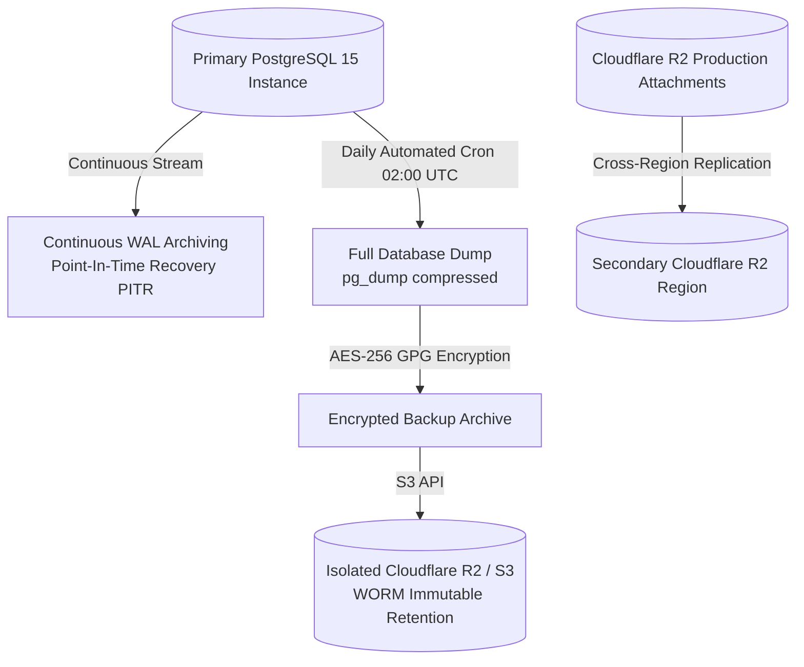

# MediNexa Backup, Restore & Disaster Recovery Runbook

**Document Version:** 1.0.0 (Production & Pilot Staging)  
**Classification:** Operational Security & Business Continuity  
**Target RPO (Recovery Point Objective):** ≤ 15 Minutes  
**Target RTO (Recovery Time Objective):** ≤ 60 Minutes

---

## 1. Enterprise Backup Strategy & Architecture



### 1.1 Backup Schedule & Retention Policy

| Backup Type | Frequency | Destination | Retention Period | Encryption |
| :--- | :--- | :--- | :--- | :--- |
| **Full Database Snapshot** | Daily at 02:00 UTC | Isolated Backup Bucket | 30 Days | AES-256 (GPG Encrypted) |
| **Continuous WAL Logs** | Every 5–15 Minutes | Managed Cloud Storage | 7 Days | Cloud Provider TLS + At-Rest |
| **Weekly Historical Archive** | Every Sunday | Cold Storage / Glacier | 12 Months | AES-256 |
| **Object Storage (R2)** | Continuous Realtime | Secondary R2 Region | Indefinite (Versioned) | Cloudflare Server-Side Encryption |

---

## 2. Step-by-Step Database Backup Procedure

To take an on-demand full database snapshot prior to any significant schema migration or system upgrade:

```bash
#!/bin/bash
set -euo pipefail

TIMESTAMP=$(date +"%Y%m%d_%H%M%S")
BACKUP_DIR="/var/backups/medinexa"
BACKUP_FILE="${BACKUP_DIR}/medinexa_prod_${TIMESTAMP}.dump"
ENCRYPTED_FILE="${BACKUP_FILE}.enc"

mkdir -p "${BACKUP_DIR}"

echo "[MediNexa BCDR] Starting full PostgreSQL backup at ${TIMESTAMP}..."

# 1. Execute pg_dump with custom compressed archive format
pg_dump "${DATABASE_URL}" \
  --format=custom \
  --no-owner \
  --no-privileges \
  --verbose \
  --file="${BACKUP_FILE}"

echo "[MediNexa BCDR] Backup completed (${BACKUP_FILE}). Encrypting with AES-256..."

# 2. Encrypt dump using symmetric GPG key
gpg --batch --yes --symmetric --cipher-algo AES256 \
  --passphrase "${BACKUP_ENCRYPTION_PASSPHRASE}" \
  --output "${ENCRYPTED_FILE}" \
  "${BACKUP_FILE}"

# 3. Upload encrypted backup to isolated disaster recovery bucket
aws s3 cp "${ENCRYPTED_FILE}" "s3://${DISASTER_RECOVERY_BUCKET}/database/daily/medinexa_prod_${TIMESTAMP}.dump.enc" \
  --endpoint-url "https://${CLOUDFLARE_R2_ACCOUNT_ID}.r2.cloudflarestorage.com"

# 4. Remove plaintext temporary dump from local filesystem
rm -f "${BACKUP_FILE}"

echo "[MediNexa BCDR] Backup uploaded successfully to disaster recovery storage."
```

---

## 3. Database Restoration Runbook (Staging / Disaster Recovery)

> [!CAUTION]
> **RESTORE ISOLATION RULE:** Never execute a restore test against active production infrastructure. Restoration drills must only be executed against a dedicated staging or recovery database instance (`RESTORE_TARGET_DATABASE_URL`).

### Step-by-Step Restoration Procedure

```bash
#!/bin/bash
set -euo pipefail

RESTORE_SOURCE_FILE="medinexa_prod_20261101_020000.dump.enc"
WORKDIR="/tmp/medinexa_restore"
mkdir -p "${WORKDIR}"

echo "[MediNexa BCDR] Downloading encrypted backup from offsite storage..."

# 1. Download backup archive from Cloudflare R2
aws s3 cp "s3://${DISASTER_RECOVERY_BUCKET}/database/daily/${RESTORE_SOURCE_FILE}" "${WORKDIR}/${RESTORE_SOURCE_FILE}" \
  --endpoint-url "https://${CLOUDFLARE_R2_ACCOUNT_ID}.r2.cloudflarestorage.com"

# 2. Decrypt backup archive
echo "[MediNexa BCDR] Decrypting archive..."
gpg --batch --yes --decrypt \
  --passphrase "${BACKUP_ENCRYPTION_PASSPHRASE}" \
  --output "${WORKDIR}/decrypted.dump" \
  "${WORKDIR}/${RESTORE_SOURCE_FILE}"

# 3. Terminate active connections on target recovery database
echo "[MediNexa BCDR] Terminating connections on target database..."
psql "${RESTORE_TARGET_DATABASE_URL}" -c "
SELECT pg_terminate_backend(pid) 
FROM pg_stat_activity 
WHERE datname = current_database() AND pid <> pg_backend_pid();
"

# 4. Restore schema and data using pg_restore
echo "[MediNexa BCDR] Restoring database schema and records..."
pg_restore \
  --dbname="${RESTORE_TARGET_DATABASE_URL}" \
  --clean \
  --if-exists \
  --no-owner \
  --no-privileges \
  --verbose \
  "${WORKDIR}/decrypted.dump"

# 5. Clean up temporary decryption files
rm -rf "${WORKDIR}"

echo "[MediNexa BCDR] Database restore complete. Executing verification queries..."
```

### Verification & Consistency Queries

After restoring, run the following verification script to confirm schema and record integrity:

```sql
-- 1. Verify primary table row counts
SELECT 'organizations' AS table_name, count(*) AS total FROM organizations
UNION ALL
SELECT 'facilities', count(*) FROM facilities
UNION ALL
SELECT 'users', count(*) FROM users
UNION ALL
SELECT 'patients', count(*) FROM patients
UNION ALL
SELECT 'appointments', count(*) FROM appointments
UNION ALL
SELECT 'inpatient_admissions', count(*) FROM inpatient_admissions;

-- 2. Verify foreign key integrity
SELECT a.id AS orphaned_appointment_id
FROM appointments a
LEFT JOIN patients p ON a.patient_id = p.id
WHERE p.id IS NULL;

-- 3. Verify latest recorded audit log timestamp
SELECT max(created_at) AS latest_audit_timestamp FROM security_audit_logs;
```

---

## 4. Cloudflare R2 Object Storage Recovery Strategy

1. **Bucket Versioning:** Bucket versioning is enabled on `medinexa-attachments`. In the event of accidental object deletion or ransomware alteration, previous versions can be restored immediately without data loss.
2. **Immutability (Object Lock):** Clinical document retention policies prevent permanent deletion of patient records for a minimum of 3 years to comply with Indian Medical Council regulations.
3. **Cross-Region Replication:** Bucket contents are replicated asynchronously to a secondary geographic Cloudflare R2 datacenter.

---

## 5. Incident Escalation & Response Matrix

| Severity Level | Definition | Target Response | Target Resolution | Escalation Contact |
| :---: | :--- | :---: | :---: | :--- |
| **P0 — Critical** | Total platform outage; database corruption; catastrophic data loss affecting clinical care. | **≤ 15 Minutes** | **≤ 60 Minutes** | CTO / DevSecOps Lead / Hospital Emergency Board |
| **P1 — High** | Major functional outage (e.g., OPD booking down, prescription dispatch failing) affecting multiple facilities. | **≤ 30 Minutes** | **≤ 2 Hours** | Senior Backend Architect / On-Call Engineer |
| **P2 — Medium** | Single non-critical service degraded (e.g., analytics slow, historical report generation delayed). | **≤ 2 Hours** | **≤ 8 Hours** | Engineering Support Lead |
| **P3 — Low** | Minor cosmetic defect, non-blocking UI inconsistency, documentation enhancement. | **≤ 1 Business Day** | Next Sprint | Frontend / Product Team |
