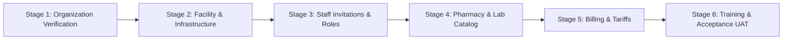

# MediNexa Real Hospital Pilot & Onboarding Checklist

**Platform:** MediNexa Connected Healthcare Enterprise Multi-Tenant SaaS  
**Target Milestone:** Pilot Hospital Go-Live (Phase 4)  
**Readiness Target:** Minimum 80% Pilot Readiness Score before live clinical operations.

---

## 1. Six-Stage Hospital Onboarding Framework



### Stage 1: Organization Registration & Compliance Verification
- [ ] **Hospital Application Submitted:** Administrator applies via `POST /api/v1/organization/onboarding/apply` with hospital legal name, slug, address, contact email, and phone.
- [ ] **Clinical Establishment License:** Upload verified copy of state Clinical Establishment Act license or equivalent accreditation.
- [ ] **Tax & Billing Identity:** Provide official GSTIN and PAN of the healthcare entity.
- [ ] **Super Admin Review:** MediNexa platform administration validates credentials and issues formal approval via `PATCH /api/v1/super-admin/organizations/:id/approve`.
- [ ] **Tenant Provisioning:** Dedicated isolated database schema and facility node automatically provisioned.

### Stage 2: Facility & Branch Physical Infrastructure
- [ ] **Departments Configured:** Setup clinical departments (General Medicine, Cardiology, Orthopedics, Pediatrics, Emergency, Surgery, Obstetrics & Gynecology, Pathology, Radiology).
- [ ] **Consultation Rooms:** Number and assign OPD consultation cabins (e.g., OPD-101 to OPD-110).
- [ ] **Inpatient Wards & Beds:** Configure General Ward, Semi-Private, Deluxe, and ICU wards with individual bed numbers.
- [ ] **Operating Theatres & Emergency Bays:** Designate Emergency Triage bays and OT suites.
- [ ] **Facility Operating Hours:** Define OPD timing windows, visiting hours, and 24x7 emergency service availability.

### Stage 3: Medical & Administrative Staff Provisioning
- [ ] **Staff Invitation Engine:** Issue invitations via `POST /api/v1/organization/invitations` using secure 64-character single-use tokens.
- [ ] **Role Assignments:** Assign specific roles:
  - Doctors (linked to department, medical council registration number, consultation fees).
  - Nurses (linked to inpatient wards / ICU).
  - Receptionists (front-desk OPD and queue management).
  - Pharmacists (dispensary and stock ledger).
  - Laboratory Technicians (sample collection and pathology).
  - Billing Executives (cash counters and discharge clearance).
- [ ] **Invitation Acceptance:** Staff members accept invitations via `POST /api/v1/organization/invitations/accept`, set passwords, and complete account setup.
- [ ] **Emergency Contact Escalation:** Establish emergency on-call rosters.

### Stage 4: Pharmacy Formulary & Laboratory Catalog
- [ ] **Medicine Formulary:** Import hospital drug master (brand name, generic chemical name, manufacturer, unit of measure, HSN code, GST rate).
- [ ] **Initial Inventory Batches:** Ingest current pharmacy stock with batch numbers, manufacturing dates, expiry dates, purchase rates, and MRPs.
- [ ] **Low-Stock Alert Thresholds:** Set minimum reorder points (e.g., 50 tablets for essential emergency drugs).
- [ ] **Laboratory Test Directory:** Configure available lab investigations (CBC, Lipid Profile, LFT, KFT, HbA1c, Troponin-I, Urine Routine, Chest X-Ray).
- [ ] **Reference Ranges & Units:** Define age- and gender-specific reference intervals for all pathology parameters.

### Stage 5: Billing, Tariffs & Financial Configuration
- [ ] **Invoice Prefix:** Configure hospital financial prefix (e.g., `HOSP-2026-`).
- [ ] **Default Consultation Fees:** Set standard OPD consultation fees and follow-up fee rules.
- [ ] **Procedure & Bed Tariffs:** Configure daily bed charges (General, ICU, Deluxe) and nursing care charges.
- [ ] **Taxation Rules:** Setup CGST/SGST exemption or applicable tax rates on medicines and consumables.
- [ ] **Accepted Payment Methods:** Enable Cash, Card, UPI, and Corporate/TPA Insurance desk workflows.

### Stage 6: Staff Training & User Acceptance Testing (UAT)
- [ ] **Role Guides Distributed:** Provide role-specific operating runbooks to all departments.
- [ ] **Synthetic Dry Run:** Execute 5 synthetic patient journeys from OPD walk-in to billing reconciliation.
- [ ] **IPD Admission Simulation:** Execute 1 complete admission, vitals recording, doctor round, and discharge workflow.
- [ ] **Hardware Verification:** Verify thermal barcode printers (laboratory), receipt printers (billing), and client desktop web browsers.

---

## 2. Measurable Pilot Acceptance Criteria (Go / No-Go Gates)

Before opening the platform for real hospital patients, the facility must satisfy all 6 mandatory gates:

| Gate # | Evaluation Gate | Success Threshold / Criteria | Gate Status |
| :---: | :--- | :--- | :---: |
| **Gate 1** | **Automated Pilot Readiness Score** | Score ≥ 80% on `GET /api/v1/organization/pilot-readiness/:facilityId` | `PASS` |
| **Gate 2** | **Zero Master Passwords / Backdoors** | All accounts authenticate via unique bcrypt passwords. CI security tests pass 100%. | `PASS` |
| **Gate 3** | **Database Concurrency Protection** | Row locks validated: zero double-booked slots, zero double-allocated beds, zero negative inventory. | `PASS` |
| **Gate 4** | **Backup & Restoration Verification** | Automated daily backup enabled; successful dry-run database restore drill completed in staging. | `PASS` |
| **Gate 5** | **Staff Onboarding & Role Verification** | At least 1 active Doctor, 1 Nurse, 1 Receptionist, 1 Pharmacist, and 1 Billing Executive configured. | `READY` |
| **Gate 6** | **Incident Escalation & Support Channel** | Support ticketing system operational; P0 emergency contact phone tree active. | `READY` |

---

## 3. Pilot Hospital Acceptance Sign-Off Sheet

```
Hospital Name: __________________________________________________
Hospital Administrator: _________________________________________
MediNexa Technical Lead: _________________________________________
Pilot Go-Live Date: _____________________________________________
Pilot Readiness Score Achieved: ________% / 100%

Signatures:

Hospital Administrator: _____________________ Date: _____________
MediNexa Implementation Lead: _______________ Date: _____________
```
