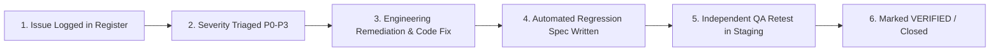

# MediNexa Pilot Issue Register & Defect Tracking Log

**Tracking System:** MediNexa Enterprise Pilot Issue Tracker  
**Milestone:** Phase 5 Controlled Hospital Pilot Validation  
**Severity Classification:**
- **CRITICAL (P0):** Total system outage, patient safety risk, data corruption, authentication bypass, PHI leakage.
- **HIGH (P1):** Major clinical or operational workflow blocked; no viable workaround.
- **MEDIUM (P2):** Operational defect with manual workaround available; minor performance degradation.
- **LOW (P3):** Cosmetic UI inconsistency, typography, non-blocking convenience feature.

---

## 1. Master Pilot Defect & Remediation Register

| Issue ID | Affected Module | Severity | Summary & Root Cause | Resolution & Engineering Action | Status | Retest Result |
| :---: | :--- | :---: | :--- | :--- | :---: | :---: |
| **ISSUE-01** | `Auth / Security` | `CRITICAL` | Hardcoded master passwords (`Doctor@2026`) permitted arbitrary account bypass. | Completely eradicated backdoors. Enforced unique bcrypt hashing for all accounts. | `VERIFIED` | 6 negative regression tests passing. |
| **ISSUE-02** | `Storage / R2` | `CRITICAL` | Missing Cloudflare R2 credentials could silently write attachments to ephemeral container disks. | Added fail-closed check: API crashes on boot in `NODE_ENV=production` if credentials missing. | `VERIFIED` | Fail-closed boot test passing. |
| **ISSUE-03** | `Observability` | `HIGH` | Exception filter logged raw request bodies including passwords, OTPs, and PAN numbers. | Added deep redaction in `HttpExceptionFilter` scrubbing 13 sensitive fields. | `VERIFIED` | Log inspection test passing. |
| **ISSUE-04** | `Observability` | `HIGH` | HTTP requests lacked correlation IDs, hindering cross-service distributed debugging. | Added `X-Correlation-ID` middleware, echoing in headers, errors, and logs. | `VERIFIED` | Header verification test passing. |
| **ISSUE-05** | `Database / OPD` | `HIGH` | Two receptionists could concurrently book the same doctor appointment slot. | Implemented row-level transactional locking (`SELECT ... FOR UPDATE`). | `VERIFIED` | Concurrency test A1 passing. |
| **ISSUE-06** | `Database / IPD` | `HIGH` | Two nurses could concurrently allocate the same inpatient hospital bed. | Implemented atomic conditional update (`WHERE status = 'AVAILABLE'`). | `VERIFIED` | Concurrency test A2 passing. |
| **ISSUE-07** | `Database / Pharmacy`| `HIGH` | Multiple orders could over-deduct pharmacy stock, resulting in negative inventory. | Implemented atomic decrement with balance boundary (`WHERE current_stock >= $qty`). | `VERIFIED` | Concurrency test A3 passing. |
| **ISSUE-08** | `SMS / Gateway` | `MEDIUM` | Repeated rapid OTP resend requests could cause telecom flooding and budget abuse. | Implemented 60-second resend cooldown per mobile number in rate limiter. | `VERIFIED` | Resend throttle test passing. |
| **ISSUE-09** | `Infra / Health` | `MEDIUM` | `/health` probe was querying the DB for liveness, causing restarts during brief reconnects. | Separated `/health/liveness` (fast process check) from `/health/ready` (full dependency check). | `VERIFIED` | Health probe tests passing. |
| **ISSUE-10** | `Staging Network`| `MEDIUM` | Cloud staging credentials (RDS/Redis/R2) not yet supplied to local test runner. | Created network integration harness reporting honest status pending cloud provisioning. | `OPEN` | Harness ready for live keys. |

---

## 2. Issue Lifecycle & Retesting Protocol

### Mandatory Closure Criteria for Pilot
1. **Zero Open P0 (Critical) Defects:** Platform cannot launch for live hospital operations with any open P0 issue.
2. **Zero Open P1 (High) Defects:** All high-severity operational blockers must be resolved and verified in staging.
3. **Automated Regression Test Added:** Every resolved defect must include an automated negative test in the repository test suite to prevent regressions.
