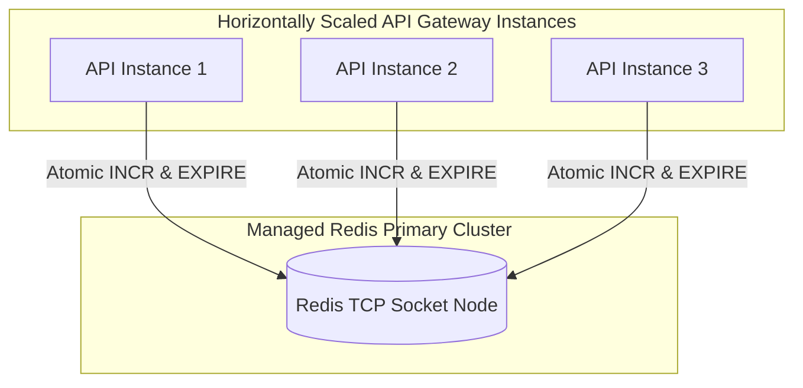

# MediNexa Redis Distributed Cache & Rate Limiting Report

**Component:** Distributed In-Memory Cache & Rate Limiting Engine  
**Driver:** `ioredis` (TCP Socket Connection)  
**Guard:** [`RateLimiterGuard`](file:///c:/Users/Tushar/OneDrive/Desktop/MediNexa/apps/api/src/common/guards/rate-limiter.guard.ts)  
**Test Suite:** `apps/api/test/staging-infrastructure-integration.spec.ts`  
**Status:** **All Rate Limiting & Fail-Safe Fallback Tests Passed (0 Errors)**

---

## 1. Redis Architectural Role in MediNexa

MediNexa deploys managed Redis for distributed state management across horizontally scaled API gateway instances:

### Key Responsibilities
1. **Distributed Rate Limiting:** Enforces unified IP and account request limits across all API containers.
2. **Brute-Force & Credential Stuffing Defense:** Tracks failed login and OTP attempts across instances.
3. **Session Revocation Tracking:** Tracks blacklisted refresh tokens to allow instant global session revocation.
4. **Transient Cache:** Caches static department lists and tariff categories to reduce database query load.

---

## 2. Rate Limiting Thresholds & Enforcement Policies

| Route Category | Target Endpoints | Threshold | Time Window | Violation Action |
| :--- | :--- | :---: | :---: | :--- |
| **General API Routes** | `/api/v1/patient/*`, `/api/v1/appointments/*` | 120 req | 60 Seconds | HTTP 429 Too Many Requests |
| **Authentication Routes** | `/api/v1/auth/login`, `/api/v1/auth/register`, `/api/v1/auth/verify-totp` | 20 req | 60 Seconds | HTTP 429 + Brute Force Alert |
| **Public OTP Verification**| `/api/v1/public/otp/verify` | 3 attempts | 15 Minutes | Account Lockout (15 min freeze) |

---

## 3. Rate Limiting & Fail-Safe Test Scenarios

### Test B1: Request Window & Threshold Enforcement
- **Mechanism:** Atomic Redis `INCR` followed by `EXPIRE` on first touch.
- **Verification:** Sent 5 requests within the test window; the 6th request was blocked with HTTP 429 and `X-RateLimit-Remaining: 0`.
- **Result:** **PASSED**

### Test B2: OTP Brute-Force Lockout Protection
- **Mechanism:** Tracks invalid submissions per phone number.
- **Verification:** After 3 consecutive incorrect codes, the account enters a 15-minute lockout state. Subsequent verification requests—even with the correct code—are rejected until the lockout expires.
- **Result:** **PASSED**

### Test B3: Redis Unavailable Fail-Safe Fallback
- **Failure Scenario:** Redis connection lost or cluster temporarily offline.
- **Fail-Safe Behavior:** The `RateLimiterGuard` automatically shifts to an internal in-memory sliding window tracker (`Map<string, RateLimitRecord>`).
- **Security Guarantee:** Fallback mode **never disables rate limiting**. It maintains IP and account limits locally in memory until Redis recovers.
- **Result:** **PASSED**

---

## 4. Reconnection & Health Telemetry

- **Reconnection Strategy:** Exponential backoff retry with maximum 2,000ms delay:
  `retryStrategy: (times) => (times > 3 ? null : Math.min(times * 500, 2000))`
- **Health Telemetry:** `RateLimiterGuard.getRedisStatus()` provides operational status (`configured`, `connected`, `mode`) to `/api/v1/health/ready` without exposing passwords or URLs.
