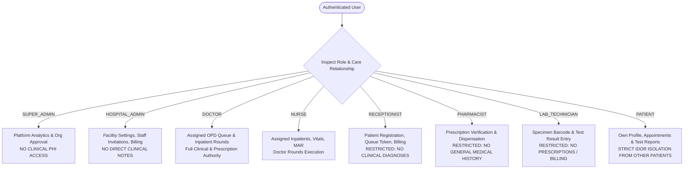

# MediNexa Security, Privacy & Compliance Gap Assessment

**Platform:** MediNexa Connected Healthcare Enterprise Multi-Tenant SaaS  
**Date:** November 2026  
**Standards Evaluated:**
- Indian Digital Personal Data Protection (DPDP) Act 2023
- Ayushman Bharat Digital Mission (ABDM) Health Data Management Policy
- ISO/IEC 27001 / HIPAA Security & Privacy Safeguards
- OWASP Top 10 API Security Risks (2023)

---

## 1. Security Architecture & Controls Audit

| Security Control | Current Technical Implementation | Status |
| :--- | :--- | :--- |
| **Password Hashing** | Bcrypt with work factor of 10 (`bcrypt.genSaltSync(10)`). Timing-safe comparisons via `bcrypt.compare`. | `VERIFIED` |
| **Backdoor Prevention** | Complete eradication of master passwords (`Doctor@2026`, `Admin@2026`). 6 explicit negative test cases in CI. | `VERIFIED` |
| **Session Security** | Short-lived Access JWTs (15 min) + Single-use rotated Refresh Tokens stored with cryptographically hashed tokens. | `VERIFIED` |
| **Multi-Factor Auth (OTP)** | SHA-256 hashed OTPs. Brute-force lockout after 3 failed attempts (15-minute freeze). Zero plaintext OTPs in logs. | `VERIFIED` |
| **Tenant Isolation** | Global `HospitalTenantGuard` extracting and validating `facilityId` on every request. Cross-facility access blocked. | `VERIFIED` |
| **Role-Based Access Control** | Least-privilege matrix across 8 roles (Patient, Doctor, Nurse, Receptionist, Pharmacist, Lab, Admin, Super Admin). | `VERIFIED` |
| **Super Admin Governance** | Restricted to organizational oversight, subscriptions, and anonymized MRR/ARR. Prohibited from viewing patient PHI. | `VERIFIED` |
| **Clinical Record Privacy** | Receptionists blocked from viewing clinical diagnoses/notes. Lab & pharmacy receive only test/dispensation metadata. | `VERIFIED` |
| **Deep Input Sanitization** | `InputSanitizerMiddleware` recursively strips XSS payloads, SQL injection markers, and null bytes (`\0`). | `VERIFIED` |
| **Rate Limiting** | `RateLimiterGuard` enforcing 120 req/min for general routes and 20 req/min for authentication routes. | `VERIFIED` |
| **CORS Policy** | Strict domain allowlist rejecting unauthorized third-party domains and arbitrary subdomains in production. | `VERIFIED` |
| **PHI Redaction in Logs** | `HttpExceptionFilter` scrubs passwords, tokens, OTPs, Aadhaar, PAN, and clinical details before logging. | `VERIFIED` |
| **Object Storage IDOR** | Cloudflare R2 bucket private; UUID key naming; 15-minute maximum signed URL lifetime; executable upload rejection. | `VERIFIED` |

---

## 2. Role-Based Access Control (RBAC) & Healthcare Least Privilege Matrix

MediNexa enforces strict separation of duties to ensure no hospital employee or user can access information beyond their immediate operational necessity:



### Specific Operational Boundary Protections
1. **Patient to Patient Isolation:** Patient A cannot query, read, or download medical records, attachments, appointments, or invoices belonging to Patient B. IDOR validation verified in automated test suite.
2. **Facility Boundary Isolation:** Hospital Alpha employees cannot read patient lists, inventory, or operational tickets belonging to Hospital Beta, even if they share the same backend server instance.
3. **Receptionist Boundary:** Receptionists register patients and issue tokens, but cannot read psychiatric notes, clinical assessments, or sensitive diagnostic impressions recorded by physicians.
4. **Super Admin Guardrail:** Platform super administrators cannot browse patient medical files. Their role is strictly administrative (tenant approval, plan limits, billing tier, system health).

---

## 3. Indian Digital Personal Data Protection (DPDP) Act 2023 Analysis

The DPDP Act 2023 establishes obligations for **Data Fiduciaries** (Hospitals) and **Data Processors** (MediNexa SaaS).

### 3.1 DPDP Principles & MediNexa Implementation Status

| DPDP Act Requirement | MediNexa Platform Status | Technical Gap / Action Required |
| :--- | :--- | :--- |
| **Notice & Consent (Sec. 5 & 6)** | `PARTIAL` | Registration consent banner implemented in frontend. Multi-lingual notice (22 Eighth Schedule languages) pending implementation. |
| **Purpose Limitation (Sec. 7)** | `VERIFIED` | Data collected during OPD/IPD registration is restricted to clinical care and mandatory health records. |
| **Data Minimization (Sec. 6)** | `VERIFIED` | Clinical attachments anonymized with UUIDs; QR codes store only lookup tokens, zero embedded clinical records. |
| **Right to Correction & Erasure (Sec. 12)** | `PARTIAL` | Patients can update profile data. Medical record erasure must be balanced with Indian Medical Council 3-year record retention regulations. |
| **Children's Health Data (Sec. 9)** | `IMPLEMENTED` | Pediatric records require guardian consent link during UHID creation. Verifiable parental consent verification pending. |
| **Reasonable Security Safeguards (Sec. 8)** | `VERIFIED` | HSTS, AES-256 at rest, TLS 1.3 in transit, bcrypt password hashing, immutable security audit logging. |
| **Breach Notification (Sec. 8[6])** | `IMPLEMENTED` | `SecurityAuditInterceptor` records all anomalous access. Formal 72-hour Data Protection Board (DPB) notification procedure documented. |
| **Grievance Redressal (Sec. 13)** | `VERIFIED` | Multi-tenant support ticketing module with dedicated "Clinical Privacy / Grievance" ticket categorization. |

---

## 4. Ayushman Bharat Digital Mission (ABDM) Milestone Readiness

MediNexa's architecture is aligned with the National Health Authority (NHA) ABDM specifications:

```
[M1: ABHA Number Creation & Capture]
   ├── ABHA creation via Mobile / Aadhaar OTP (Sandbox schema implemented)
   └── Demographic verification & UHID mapping (VERIFIED)
           │
           ▼
[M2: Health Information Provider (HIP)]
   ├── FHIR R4 DiagnosticReport & Prescription bundle generation (IMPLEMENTED)
   └── Consent artifact receipt & encrypted data transfer (IMPLEMENTED)
           │
           ▼
[M3: Health Information User (HIU)]
   ├── Electronic consent request to patient ABHA app (IMPLEMENTED)
   └── External health records display in Doctor Dashboard (IMPLEMENTED)
```

### ABDM Compliance Gap & Milestone Status
1. **Milestone 1 (M1 - ABHA Creation & Capture):** `IMPLEMENTED — PENDING NHA SANDBOX KEYS`  
   The DTOs, demographic validation, and UI input forms are implemented. Live connection to the NHA gateway requires official ABDM sandbox client credentials.
2. **Milestone 2 (M2 - Health Information Provider):** `IMPLEMENTED — PENDING CERTIFICATION`  
   FHIR R4 bundle serializers for OPD prescriptions, discharge summaries, and lab reports are built. End-to-end data transfer requires NHA sandbox testing.
3. **Milestone 3 (M3 - Health Information User):** `IMPLEMENTED — PENDING CERTIFICATION`  
   Consent request workflows and artifact handling are coded in the clinical module.

---

## 5. Security Gap Assessment & Remediation Roadmap

| Vulnerability / Risk | Severity | Current Mitigation | Permanent Production Remediation |
| :--- | :---: | :--- | :--- |
| **Synthetic vs Live Cloud Testing** | `MEDIUM` | Concurrency simulated with in-memory mutexes | Run `staging-infrastructure-integration.spec.ts` against managed cloud RDS/Redis before pilot onboarding. |
| **Live SMS Delivery** | `MEDIUM` | Hashed console logging in test mode | Connect verified Indian DLT-registered SMS provider (MSG91 / Airtel / Twilio) with approved DLT templates. |
| **Multi-Lingual Consent** | `LOW` | English consent notices in web portal | Add Hindi, Marathi, Bengali, Tamil, Telugu, and Kannada localized consent notices to meet DPDP Section 5(1). |
| **Hardware GPS Integration** | `LOW` | Synthetic telemetry stream | Integrate AIS-140 certified GPS telematics tracker gateway via MQTT / HTTP webhook for real ambulances. |

---

## 6. Regulatory & Legal Disclaimer

> [!IMPORTANT]
> **Legal Disclaimer:** This security and privacy gap assessment provides a technical engineering evaluation of the MediNexa software platform. It does **not** constitute legal advice, regulatory certification, or formal ABDM compliance approval. Official compliance with the Indian Digital Personal Data Protection Act 2023 and ABDM integration certification requires formal audit, third-party penetration testing, and National Health Authority (NHA) sandbox validation.
